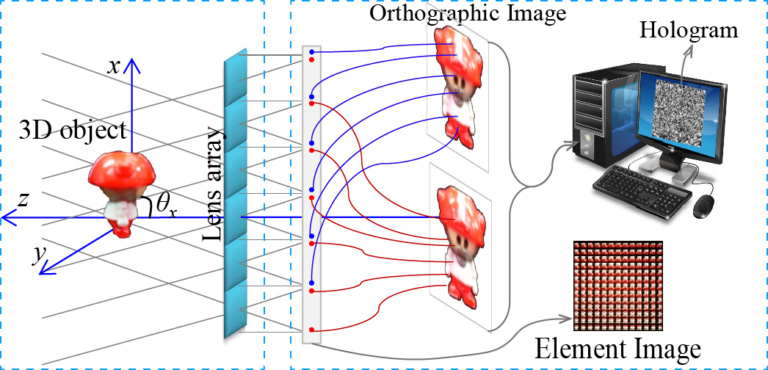
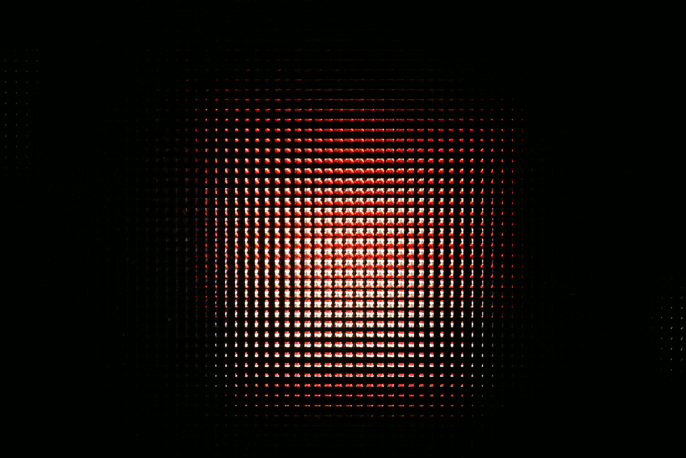
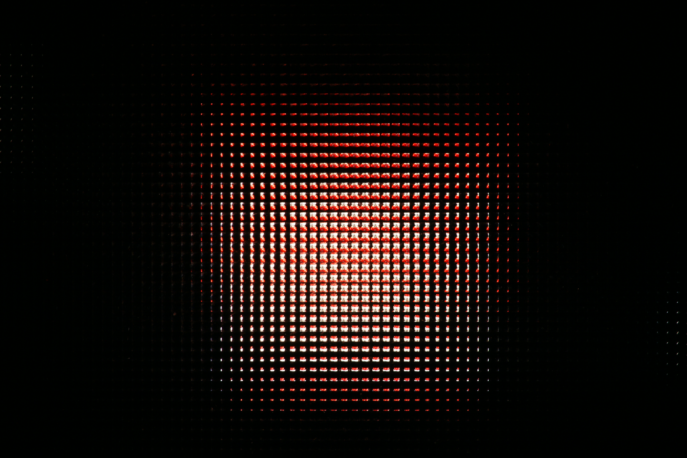
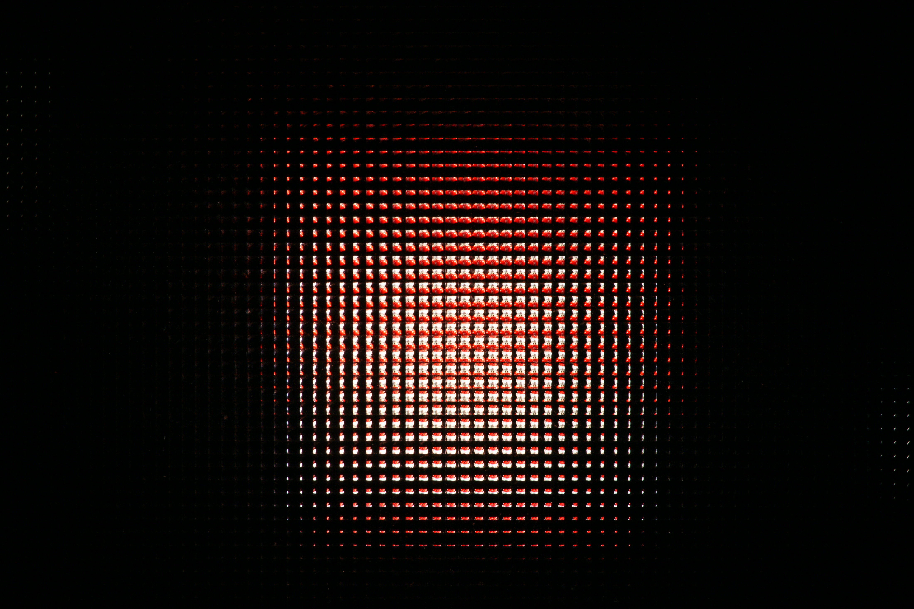

# Integral Imaging-Based Synthetic Holography

This project explores the synthesis and resolution enhancement of holograms from
light-field and orthographic-view images.

|  |
|:--:|
| Schematic of hologram synthesis from orthographic-view images |

## Resolution enhancement

An example set of captured elemental images:

|  |  |
|:--:|:--:|
|  |  |

The approach combines captured views to synthesize elemental images and improve
the resolution of the resulting hologram.

## Resources

- [Source code](https://github.com/Ni-Chen/LF-based-Synthetic-Holography/tree/main/code)
- [Research papers](https://github.com/Ni-Chen/LF-based-Synthetic-Holography/tree/main/papers)
- [Project repository](https://github.com/Ni-Chen/LF-based-Synthetic-Holography)

## References

- Min Wan, Inbarasan Muniraj, Ra’ed Malallah, Ni Chen, John J. Healy, James P. Ryle, and John T. Sheridan, “Orthographic projection images based photon counted integral Fourier holography”, *Applied Optics*, 58(10):2656–2661, Mar. 2019.
- Ni Chen, Zhenbo Ren, and Edmund Y. Lam, “High resolution Fourier hologram synthesis from photographic images through computing the light field”, *Applied Optics*, 55(7):1751–1756, Mar. 2016.
- Ni Chen, Jiwoon Yeom, Jae-Hyun Jung, Jae-Hyeung Park, and Byoungho Lee, “Resolution comparison between integral-imaging-based hologram synthesis methods using rectangular and hexagonal lens arrays”, *Optics Express*, 19(27):26917–26927, Dec. 2011.
- Ni Chen, Jae-Hyeung Park, and Nam Kim, “Parameter analysis of integral Fourier hologram and its resolution enhancement”, *Optics Express*, 18(3):2152–2167, Jan. 2010.
